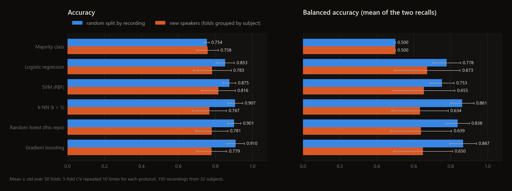
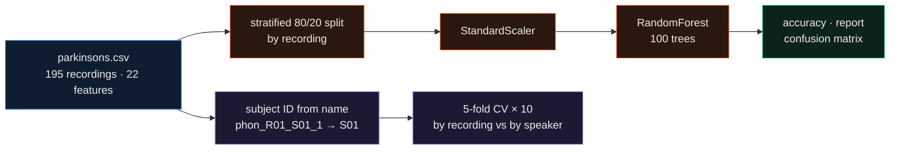
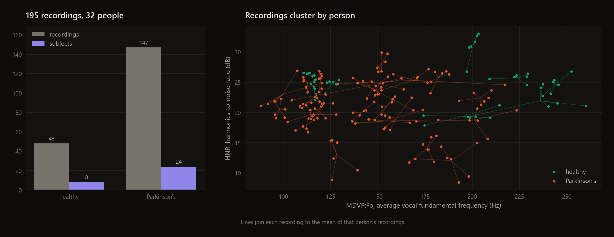
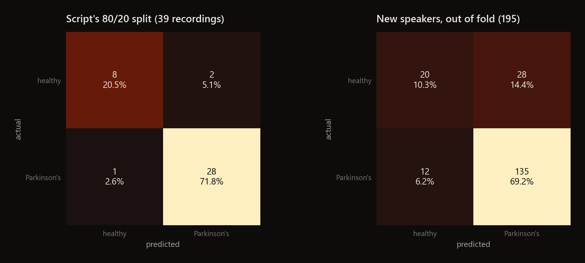

<div align="center">

# Parkinson's Disease Classification

**A random forest that flags Parkinson's disease from 22 voice measurements, evaluated on recordings and on speakers it has never heard.**




</div>

The data is the UCI Parkinson's voice dataset (Little et al., 2007, via [Kaggle](https://www.kaggle.com/datasets/vikasukani/parkinsons-disease-data-set)):
195 sustained-vowel recordings described by 22 acoustic measures such as jitter, shimmer, harmonics-to-noise ratio
and pitch entropy. `parkinsons_classification.py` scales the features, trains a 100-tree random forest on a random
80% of the recordings and scores the rest. The catch is that each person contributes six or seven recordings, so a
random split tests the model on voices it has already trained on. I re-ran the evaluation with whole speakers held
out to see what the model does on a new person.

## Highlights

- On the script's split the forest gets 0.923 accuracy (36 of 39 recordings). Every one of those 39 test recordings comes from a speaker who also has recordings in the training set.
- Holding out whole speakers drops the forest from 0.901 to 0.781 accuracy, against 0.758 for always predicting Parkinson's. Balanced accuracy falls from 0.838 to 0.639.
- All five real models lose 6 to 14 points the same way, so this is a property of the data split, not of the forest.
- Voice features are mostly personal: for the median feature, 78.6% of its variance lies between people rather than between one person's recordings (94.4% for fundamental frequency).
- In one speaker-grouped pass the forest recognises only 20 of 48 healthy recordings, and a per-person majority vote gets 4 of the 8 healthy people right.

---

## How it works



The `name` column encodes the speaker (`S01` to `S50`, 32 distinct codes: 24 with Parkinson's, 8 healthy).
`scripts/make_figures.py` uses it to build folds where every recording of a person lands in the same fold, dealing
healthy and Parkinson's speakers out separately so each fold keeps both classes.

## Results

Both protocols use 5-fold cross-validation repeated 10 times (50 folds) on all 195 recordings; "by speaker" means no
person appears in both the training and the test part of a fold.

| model | accuracy, by recording | accuracy, by speaker | balanced acc., by recording | balanced acc., by speaker |
|---|---|---|---|---|
| Majority class | 0.754 | 0.758 | 0.500 | 0.500 |
| Logistic regression | 0.853 | 0.783 | 0.778 | 0.673 |
| SVM (RBF) | 0.875 | 0.816 | 0.753 | 0.655 |
| k-NN (k = 5) | 0.907 | 0.767 | 0.861 | 0.634 |
| Random forest (this repo) | 0.901 | **0.781** | 0.838 | **0.639** |
| Gradient boosting | 0.910 | 0.779 | 0.867 | 0.650 |



The scatter shows why the random split flatters the model. A person's recordings sit close together, so a test
recording usually has near-twins from the same voice in the training set, and k-NN, which relies on exactly that,
loses the most (0.907 to 0.767).



## Quickstart

```bash
git clone https://github.com/EllE961/Parkinson-s-Disease-Kaggle.git
cd Parkinson-s-Disease-Kaggle
pip install -r requirements.txt
python parkinsons_classification.py   # correlation heatmap, accuracy, report, confusion matrix (plots open in windows)
python scripts/make_figures.py        # both CV protocols for 6 models + docs/assets/*.png (~1.5 min)
```

## Repository map

```text
parkinsons_classification.py   split, scaling, random forest, evaluation and plots
scripts/make_figures.py        speaker-grouped vs random CV, confusion matrices, figures
data/parkinsons.csv            195 recordings × (name, 22 features, status)
docs/assets/                   figures in this README
requirements.txt               numpy, pandas, scikit-learn, matplotlib, seaborn
```

## Limitations

- 32 speakers, 8 of them healthy, is a very small sample of people. The by-speaker accuracy varies by ± 0.087 between folds, and one healthy speaker more or less in a fold moves it a lot.
- The 22 features were computed by the dataset authors; there is no raw audio here, so nothing about the signal processing can be changed.
- The model is untuned and unweighted. Healthy recall is the weak point (20 of 48 recordings on unseen speakers), and class weights or a lower threshold would be the first thing to try.
- The script itself still reports the random-split number. The speaker-grouped protocol lives only in `scripts/make_figures.py`.

## License

MIT, see [LICENSE](LICENSE).
